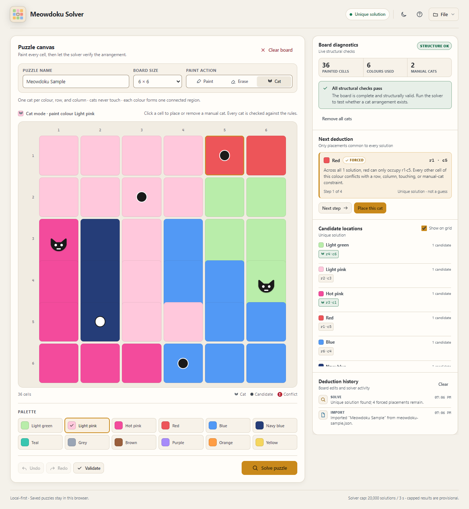

<p align="center">
  
</p>

<h1 align="center">Meowdoku Solver</h1>

<p align="center">
  A local-first workbench for painting cat-placement puzzles, checking their structure, and enumerating valid solutions.
</p>

<p align="center">
  <a href="LICENSE"></a>
  
  
</p>

Meowdoku Solver is a browser-only puzzle tool. Paint a grid into connected colour regions, place any cats you already know, and ask the solver to enumerate valid cat arrangements within its documented search caps. It is plain HTML, CSS, and JavaScript: no installation, package manager, bundler, backend, analytics, or runtime network dependency.

<p align="center">
  <picture>
    <source media="(prefers-color-scheme: dark)" srcset="assets/screenshots/workspace-dark.png">
    <source media="(prefers-color-scheme: light)" srcset="assets/screenshots/workspace-light.png">
    
  </picture>
</p>

<p align="center"><sub>Actual capture of the app: a 6 × 6 puzzle with two manual cats and four candidate cells. Switch GitHub's theme to see the matching light or dark render.</sub></p>

## Live demo

**Deployment target:** <https://knightlesssword.github.io/meowdoku-solver/>

> **Status:** GitHub Pages publication is handled in the repository's release phase. The URL above is the intended public address; it had not been verified as live when this document was written. Use the local setup below until the first deployment is confirmed.

## Features

- **Boards from 4 × 4 to 10 × 10** with row and column rulers.
- **Twelve-colour palette** in a 6 / 4 / 3 responsive grid, with Paint, Erase, and Cat modes.
- **Live diagnostics** for unpainted cells, disconnected colour regions, cats on unpainted cells, and row, column, colour, or touching-cat conflicts.
- **Constraint solver** with candidate overlays, solution counts, and forced deductions that are common to every enumerated solution.
- **Manual cats as hard constraints**, so a known placement restricts the search instead of being ignored.
- **Undo and redo**, a bounded activity history, and keyboard board navigation.
- **Local named saves**, an automatic recovery point before validation or solving, and JSON import/export.
- **Dark and light themes**, responsive layout, reduced-motion support, and keyboard-accessible dialogs and panels.
- **No build step and no runtime dependencies.** Open the HTML file or serve the folder with any static file server.

## Rules

1. **Paint every cell.** The solver only searches a complete board.
2. **Use exactly one cat per used colour.** On an `n × n` board, a valid puzzle uses exactly `n` colours.
3. **Use exactly one cat per row and per column.** Because there are `n` cats on an `n × n` board, every row and column is covered.
4. **Cats never touch.** The eight surrounding cells, including diagonals, are forbidden.
5. **Each colour forms one orthogonally connected region.** Diagonal contact does not connect same-colour cells.
6. **There is no maximum region size.** A single colour may cover any number of cells as long as it remains one connected region.
7. **Manual cats are hard constraints.** Any cat placed by hand must appear in every solution the solver reports.

## How the solver works

The solver is a bounded backtracking search, not a random or heuristic guesser.

1. **Validate the structure first.** `analyze()` checks the painted cells, connected components, colour count, manual-cat conflicts, and row/column/cat rules. Empty, incomplete, or structurally invalid boards are blocked before the search starts.
2. **Search by colour with minimum-remaining-values ordering.** At each step, the solver chooses the unassigned colour with the fewest legal cells. A cell is legal only if its row and column are free, none of its eight neighbours already contains a cat, and it matches any manual cat for that colour.
3. **Enumerate solutions.** Every completed assignment is recorded. Candidate lists contain each cell that appeared in at least one enumerated solution.
4. **Report deductions only after a complete search.** A placement is shown as forced only when it appears in every solution found. Forced steps are suppressed when the search is capped; candidate overlays remain available but are marked provisional.
5. **Fail honestly.** A capped search with at least one solution is reported as provisional. A capped search with no solution yet is reported as inconclusive, not as proof that the puzzle is impossible.

| Result | Meaning |
|---|---|
| `Unique solution` | The search completed and found exactly one arrangement. |
| `N solutions` | The search completed and found more than one arrangement. |
| `No solution` | The search completed and found none. |
| `Provisional results` | The solution cap or time limit was reached after at least one solution; results are incomplete. |
| `Search inconclusive` | The cap or time limit was reached before any solution was found; no conclusion is possible. |

The hard limits are **20,000 enumerated solutions** and **3 seconds** of search time. The search runs on the main thread, so a difficult board can briefly make the page less responsive near those limits. A 40-entry activity history and the solver caps bound the main growth paths.

## Getting started

There is nothing to install or build.

### Option 1: open the file

Open `index.html` in a modern browser. The app loads its CSS, JavaScript, and icon with relative paths, so this works without a server in Chromium. Some browsers restrict `localStorage` or other features on `file://` pages; use a local server if saving does not work.

### Option 2: serve the folder

From the repository root:

```powershell
python -m http.server 8765 --bind 127.0.0.1
```

Then open <http://127.0.0.1:8765/>.

Any static server works. There is no `npm install`, build command, or generated output directory.

## Using the app

1. Enter a puzzle name and choose a board size.
2. Paint regions with the twelve-colour palette. Use **Erase** to remove paint and any cat in a cell.
3. Switch to **Cat** to place or remove manual cats.
4. Run **Validate** for live structural diagnostics. This also writes the automatic recovery point.
5. Run **Solve puzzle** to enumerate arrangements.
6. Review **Candidate locations** and **Next deduction**. Use **Next step** and **Place this cat** only when the result is complete enough to support a forced placement.
7. Save a named puzzle in this browser, or use **File → Export JSON** for a portable copy.

Useful shortcuts: arrow keys move around the board; <kbd>Enter</kbd> or <kbd>Space</kbd> applies the active mode; <kbd>Ctrl</kbd>/<kbd>Cmd</kbd> + <kbd>Z</kbd> undoes; <kbd>Ctrl</kbd>/<kbd>Cmd</kbd> + <kbd>Shift</kbd> + <kbd>Z</kbd> redoes; <kbd>Ctrl</kbd>/<kbd>Cmd</kbd> + <kbd>S</kbd> saves; <kbd>Ctrl</kbd>/<kbd>Cmd</kbd> + <kbd>O</kbd> opens the saved-puzzle list.

## Data and local storage

All puzzle data stays in the current browser profile. There is no account, server-side storage, telemetry, or upload.

| Key | Purpose |
|---|---|
| `cat-solver:<name>` | Named puzzles saved with **File → Save puzzle**. |
| `meowdoku:autosave:v1` | Automatic recovery point written immediately before Validate or Solve. |
| `cat-solver-theme` | Last selected dark or light theme. |

- **Named saves** are separate from the autosave and can be overwritten only after a confirmation when the same name already exists.
- **Autosave** is written before analysis and before early returns, so even an incomplete or invalid board can be recovered. It is removed when Validate or Solve runs on an empty board, when the user chooses **Start fresh**, or when a stored value is malformed. A failed write removes the older recovery point so it cannot be mistaken for the current board.
- **Startup recovery** offers **Restore board** or **Start fresh** when a valid non-empty autosave exists. Restoring keeps the recovery point, so the same snapshot can be offered again on a later load.
- **Storage is not encrypted, confidential, or a backup.** It can be cleared by browser settings, private-browsing cleanup, or site-data removal. Export important puzzles as JSON.
- **Origins are separate.** A puzzle saved at `http://127.0.0.1:8765` is not visible at the GitHub Pages origin, and vice versa.
- **Import limit:** JSON files larger than 5 MB are rejected before reading. Imports are validated before the current board is replaced.
- **Blocked storage:** if `localStorage` is unavailable or full, validation and solving still run; saving may fail with an actionable message.

## JSON format

Exports and named saves use schema version 2. Versions 1 and 2 are accepted on import; newer or unknown versions are rejected.

```json
{
  "version": 2,
  "name": "Example puzzle",
  "n": 6,
  "cells": [1, 1, 1, 1, 3, 3, 1, 1, 1, 1, 0, 0, 2, 5, 1, 4, 0, 0, 2, 5, 1, 4, 4, 0, 2, 5, 1, 1, 4, 4, 2, 2, 2, 4, 4, 4],
  "cats": [12, 23],
  "selected": 1,
  "mode": "cat"
}
```

- `n` is an integer from 4 to 10.
- `cells` contains exactly `n × n` integers: `-1` for unpainted, or a palette index from `0` to `11`.
- `cats` contains unique cell indices in the range `0` to `n × n - 1`; they are sorted in new exports.
- `selected` is the active palette index. Legacy `-1` is normalized to `0`.
- `mode` is `paint`, `erase`, or `cat`.
- The retired `maxRegion` property from older data is accepted and ignored. New saves and exports omit it.
- `savedAt` is optional metadata used for display and sorting.

A structurally valid file can still describe an incomplete or rule-breaking puzzle. Import validation checks the data shape; the diagnostics panel checks the puzzle.

## Project structure

```text
.
├── index.html                 # Document shell, dialogs, and SVG icon sprite
├── css/
│   └── style.css              # Tokens, themes, layout, components, responsive rules
├── js/
│   └── app.js                 # State, rendering, validation, solver, persistence
├── assets/
│   ├── branding/
│   │   ├── app-icon.svg       # Header mark and favicon
│   │   └── logo-horizontal.svg
│   └── screenshots/           # Actual app captures used by this README
├── docs/
│   ├── ARCHITECTURE.md
│   ├── BRAND.md
│   ├── DEPLOYMENT.md
│   ├── IMPLEMENTATION_REPORT.md
│   ├── QUALITY_AUDIT.md
│   └── TESTING.md
├── .github/                   # Issue and pull-request templates
├── CHANGELOG.md
├── CODE_OF_CONDUCT.md
├── CONTRIBUTING.md
├── LICENSE
├── SECURITY.md
└── README.md
```

The application is three primary files: `index.html`, `css/style.css`, and `js/app.js`. The theme bootstrap in `index.html` is the only inline script; it applies the stored theme before first paint.

## Testing and browser support

The executed checks and their exact environment are recorded in [`docs/TESTING.md`](docs/TESTING.md). The current evidence includes:

- Chromium 131 headless runs for board editing, keyboard operation, dialogs, themes, responsive layouts, import/export, local storage, autosave failure, and the solver matrix from 4 × 4 through 10 × 10.
- Axe 4.10.2 scans with zero reported violations across the tested empty and populated states, in both themes and at desktop and mobile widths.
- Static checks for JavaScript syntax, duplicate IDs, inline handlers, external references, and asset paths.

This is not a claim of complete accessibility or cross-browser support. Firefox and Safari, real screen readers, physical touch devices, low-end performance, and a production Pages deployment were not verified in this environment. Axe zero violations do not prove WCAG conformance. There is no committed CI test suite; the browser harness lived outside the repository and is described in the test report.

## Contributing

Contributions are welcome. Read [`CONTRIBUTING.md`](CONTRIBUTING.md) for local setup, coding conventions, testing expectations, and commit rules. By participating, you agree to follow the [`CODE_OF_CONDUCT.md`](CODE_OF_CONDUCT.md).

Keep the project dependency-free and preserve the three-file architecture unless a documented change justifies something else.

## Security

Please do not report vulnerabilities in a public issue. See [`SECURITY.md`](SECURITY.md) for supported versions and private reporting guidance. The current security posture, accepted risks, and deferred checks are documented in [`docs/QUALITY_AUDIT.md`](docs/QUALITY_AUDIT.md).

## License

Released under the [MIT License](LICENSE). Copyright © 2026 knightlesssword.
